# reshax123

I write software and I take hardware apart. Mostly both in the same afternoon: full-stack apps with React, PHP, and Flutter on the front, and local gateways standing between AI clients and upstream providers on the back. The thread running through it is *local-first* — a service I run on my own machine, that I can read top to bottom, and that keeps working when someone else's endpoint does not.

## Selected work

Every entry below is a fork, and says so. Each one is a project I maintain and modify — attribution goes to the upstream author, the changes over it are mine.

| Project | What it is | Changed from | Stack |
| --- | --- | --- | --- |
|  **[Cartethyia2](https://github.com/reshax123/Cartethyia2)** fork of [risunCodex/Cartethyia](https://github.com/risunCodex/Cartethyia) | Self-hosted multi-provider AI gateway. One stable OpenAI- and Anthropic-compatible endpoint in front of provider-aware translation, account selection, health-aware failover, quota and cooldown enforcement, usage accounting, and telemetry. Point OpenCode, Cline, Claude Code, Codex, or any compatible client at it; the client keeps its native protocol. | Kept current with the mirror line, local build and local SQLite/Postgres run | `Bun` `TypeScript` `Elysia` `SQLite` |
|  **[Cartethyia](https://github.com/reshax123/Cartethyia)** fork of [risunCode/Cartethyia](https://github.com/risunCode/Cartethyia) | The earlier line: self-hosted Bun + Elysia AI proxy with an authenticated dashboard. Kept around because the two generations behave differently against the same providers. | Preserved build of the pre-rewrite line, on its own branch | `Bun` `TypeScript` `Elysia` |
|  **[Qoder Local Gateway](https://github.com/reshax123/Qoder-Local-Gateway)** fork of [ShinRyu04/Qoder-Local-Gateway](https://github.com/ShinRyu04/Qoder-Local-Gateway) | Local-only OpenAI / Anthropic HTTP adapter for the Qoder CLI — receives compatible API requests, translates them into CLI invocations, converts the output back. Used to study protocol differences across local clients: message formats, streaming responses, tool-call schemas. | Multi-account profiles with isolated `HOME`, OAuth login links, credit metering with burn rate and pacing | `TypeScript` `Node` |
|  **[zcode-bridge-mod](https://github.com/reshax123/zcode-bridge-mod)** fork of [ShinRyu04/Zcode-Fucking-Mod](https://github.com/ShinRyu04/Zcode-Fucking-Mod) | OpenAI- and Anthropic-compatible HTTP front end for the ZCode start-plan quota, as a single static Go binary on the standard library alone. Includes `POST /v1/responses` for Codex CLI, a native request inspector, and throughput metering from upstream usage blocks. | Windows build and local dashboard run, bilingual console | `Go` `stdlib only` |

## Stack

- **Frontend** — `TypeScript` `React` `Next.js` `Tailwind` `PHP` `Flutter`
- **Runtime & services** — `Bun` `Node` `Elysia` `Go` · single-binary and embedded-database deployments
- **Data** — `SQLite` `PostgreSQL` `Redis`
- **Hardware** — diagnostics, teardown, component-level repair

## Currently

- Running the Cartethyia line locally as my daily gateway, and keeping it current with upstream
- Going deeper on the adapter layer: provider-aware translation and quota accounting
- Keeping everything I run deployable from a single command

## Elsewhere

[atmajayatech.my.id](https://atmajayatech.my.id)
